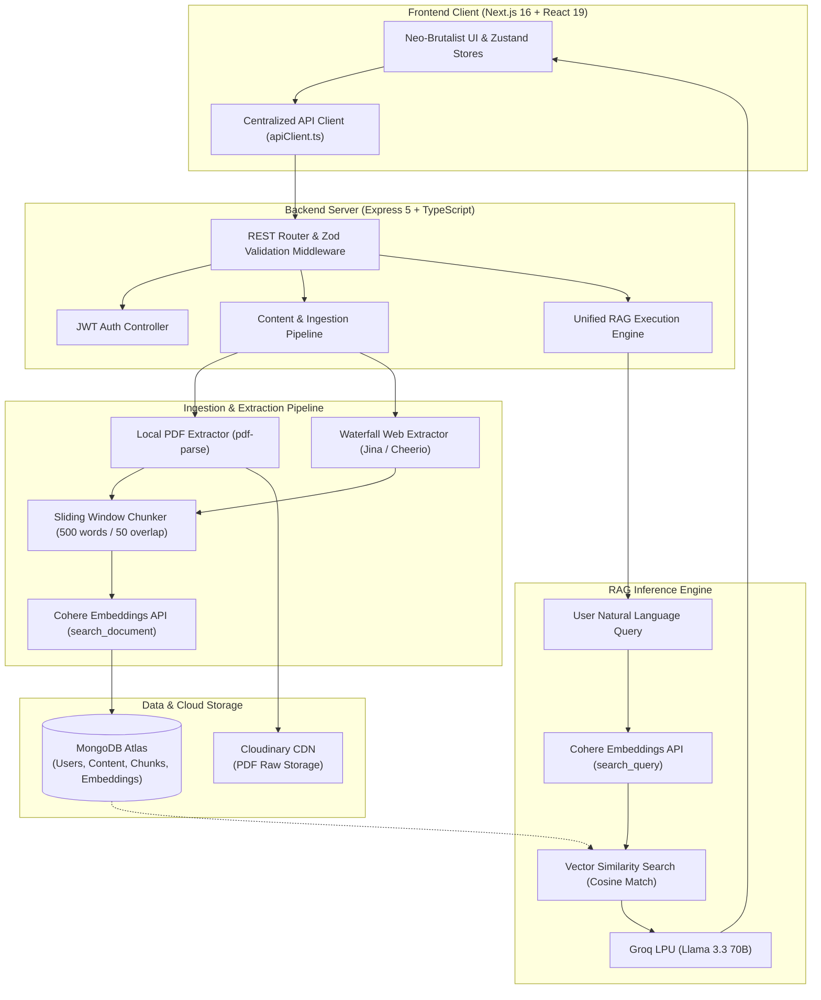
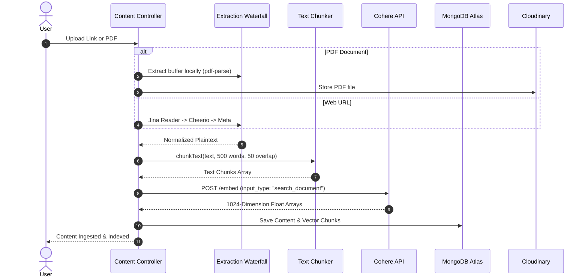

<div align="center">

# 🧠 SYNAPZ

### **Autonomous AI-Powered "Second Brain" & Personal Knowledge Engine**

*Capture everything. Index semantically. Query effortlessly with source-grounded LLM intelligence.*

[](https://synapz-gamma.vercel.app)
[](https://nextjs.org/)
[](https://react.dev/)
[](https://www.typescriptlang.org/)
[](https://groq.com/)
[](https://cohere.com/)
[](https://www.mongodb.com/)
[](LICENSE)

[**Explore Live Demo »**](https://synapz-gamma.vercel.app) · [**Report Bug**](https://github.com/Suryansh-singh-137/Synapz/issues) · [**Request Feature**](https://github.com/Suryansh-singh-137/Synapz/issues)

</div>

---

## ⚡ Overview

**SYNAPZ** is a modern, full-stack AI knowledge management system and **Second Brain** designed to eliminate information overload. Instead of bookmarking articles, PDFs, YouTube videos, tweets, and notes in fragmented apps, SYNAPZ unifies them into a single, semantically indexed neural database.

Powered by a custom **Retrieval-Augmented Generation (RAG)** pipeline—built from first principles without bulky framework abstractions—SYNAPZ synthesizes answers in real time with exact source attribution.

---

## ✨ Key Features

- 📥 **Omnichannel Ingestion**: Ingest web articles, PDF documents, YouTube videos, tweets, and plain text thoughts seamlessly.
- 📑 **Pre-Upload PDF Parsing**: Local in-memory extraction using `pdf-parse` extracts text layers before cloud storage, bypassing strict CDN authentication barriers.
- 🌐 **Waterfall Web Extraction**: Multi-tier extraction strategy: **Jina AI Reader** $\rightarrow$ direct DOM scraping via **Cheerio** $\rightarrow$ OpenGraph/Meta tag extraction fallback.
- 🧬 **Asymmetric Vector Embeddings**: Utilizes **Cohere `embed-english-v3.0`** (1024 dimensions) using differentiated modes (`search_document` for indexing, `search_query` for retrieval).
- 💬 **Grounded RAG Dialogue**: Query your knowledge base via **Groq's LPU** running `llama-3.3-70b-versatile` with zero-hallucination system constraints and click-to-source attribution.
- 🔗 **Public Cryptographic Sharing**: Generate unique, shareable tokenized links allowing friends, colleagues, or recruiters to interact with your curated brain.
- 🎨 **Neo-Brutalist Aesthetic**: Clean, minimalist monochrome design system built on **Tailwind CSS v4** with instant optimistic state updates via **Zustand**.
- 🛡️ **Full-Stack Type Safety**: End-to-end schema validation from HTTP request bodies to client inputs powered by **Zod**.

---

## 🏗️ System Architecture



---

## 🔬 How the Custom RAG Engine Works

SYNAPZ purposefully avoids black-box frameworks like LangChain or LlamaIndex in favor of an auditable, high-performance RAG implementation:

### 1. Ingestion & Indexing Phase


### 2. Retrieval & Generation Phase
1. **Embedding**: The user's query is converted into a 1024-dimensional vector using `input_type: "search_query"`.
2. **Cosine Similarity**: The vector is compared against all chunks belonging to that specific user:
   $$\text{Similarity}(A, B) = \frac{A \cdot B}{\|A\| \|B\|}$$
3. **Context Assembly**: The top-$K$ ($K=5$) most relevant chunks are compiled into an isolated prompt envelope containing exact source titles and metadata.
4. **Constrained Generation**: **Groq's Llama 3.3 70B** is instructed via strict system prompts to answer exclusively using the supplied context, returning the generated response alongside source cards.

---

## 💻 Tech Stack

### **Frontend**
| Technology | Version | Purpose |
| :--- | :--- | :--- |
| **Next.js** | `16.2.3` | App Router, Server/Client components, dynamic routing |
| **React** | `19.2.4` | Modern UI primitives, hooks, concurrent rendering |
| **Tailwind CSS** | `v4` | High-performance CSS-first styling & brutalist aesthetics |
| **Zustand** | `5.0.13` | Lightweight client-side reactive state management |
| **Zod** | `4.4.3` | Schema definition and client-side form validation |

### **Backend**
| Technology | Version | Purpose |
| :--- | :--- | :--- |
| **Express.js** | `v5.1.0` | High-throughput REST API routing |
| **TypeScript** | `v5.8.3` | Strict static typing across entire application logic |
| **Mongoose** | `v8+` | MongoDB object modeling and schema management |
| **pdf-parse** | `v1.1.1` | Local binary PDF text extraction |
| **Cheerio** | `v1.2.0` | Server-side DOM parsing and HTML sanitation |
| **Multer** | `v2.1.1` | Multipart form data and file upload middleware |
| **JWT & bcrypt** | — | Cryptographic password hashing and authentication tokens |

### **AI & Cloud Infrastructure**
| Provider | Service | Implementation |
| :--- | :--- | :--- |
| **Groq** | `llama-3.3-70b-versatile` | Ultra-fast LLM inference engine for RAG answering |
| **Cohere** | `embed-english-v3.0` | 1024-dimensional semantic text embeddings |
| **Jina AI** | Reader API (`r.jina.ai`) | Markdown-friendly web content scraping |
| **Cloudinary** | Raw Storage API | Cloud hosting for uploaded PDF attachments |
| **MongoDB Atlas** | Cloud Database | Multi-tenant document database storing vectors and content |
| **Vercel** | Edge Network | Frontend deployment and continuous integration |
| **Render** | Cloud Compute | Backend deployment and Dockerized hosting |

---

## 🚀 Getting Started

### Prerequisites

Ensure you have the following installed:
- **Node.js** $\ge 20.0.0$
- **npm** $\ge 10.0.0$
- Accounts with **MongoDB Atlas**, **Groq**, **Cohere**, and **Cloudinary**.

### 1. Clone the Repository

```bash
git clone https://github.com/Suryansh-singh-137/Synapz.git
cd Synapz
```

### 2. Configure Environment Variables

#### Backend Configuration (`backend/.env`):
```env
PORT=5000
MONGO_URL=mongodb+srv://<username>:<password>@cluster.mongodb.net/synapz?retryWrites=true&w=majority
JWT_SECRET=your_super_secret_jwt_key_here
GROQ_API_KEY=gsk_your_groq_api_key
COHERE_API_KEY=your_cohere_api_key
CLOUDINARY_CLOUD_NAME=your_cloud_name
CLOUDINARY_API_KEY=your_cloudinary_api_key
CLOUDINARY_API_SECRET=your_cloudinary_api_secret
FRONTEND_URL=http://localhost:3000
```

#### Frontend Configuration (`frontend/.env.local`):
```env
NEXT_PUBLIC_API_URL=http://localhost:5000/api/v1
```

### 3. Install & Run Locally

```bash
# Terminal 1: Start Backend (Port 5000)
cd backend
npm install
npm run dev

# Terminal 2: Start Frontend (Port 3000)
cd frontend
npm install
npm run dev
```

Visit [`http://localhost:3000`](http://localhost:3000) in your browser.

---

## 📡 API Reference

### 🔐 Authentication
| Method | Endpoint | Description | Payload |
| :--- | :--- | :--- | :--- |
| `POST` | `/api/v1/signup` | Register a new user | `{ "username": "...", "password": "..." }` |
| `POST` | `/api/v1/signin` | Authenticate user & receive JWT | `{ "username": "...", "password": "..." }` |

### 📚 Content Management *(Requires `Authorization: Bearer <token>`)*
| Method | Endpoint | Description | Payload |
| :--- | :--- | :--- | :--- |
| `GET` | `/api/v1/content` | Fetch all user content | — |
| `POST` | `/api/v1/content` | Ingest link or PDF file | JSON or `multipart/form-data` |
| `DELETE` | `/api/v1/content` | Delete a saved content item | `{ "contentId": "..." }` |

### 🧠 Knowledge Engine & Brain Sharing
| Method | Endpoint | Auth | Description |
| :--- | :--- | :--- | :--- |
| `POST` | `/api/v1/brain/chat` | Bearer Token | Ask a natural language question against your brain |
| `POST` | `/api/v1/brain/share` | Bearer Token | Generate or fetch public shareable hash link |
| `DELETE` | `/api/v1/brain/share` | Bearer Token | Deactivate public sharing |
| `GET` | `/api/v1/brain/:hash` | **Public** | Fetch sanitized public brain overview & content |
| `POST` | `/api/v1/brain/:hash/chat` | **Public** | Ask questions against a publicly shared brain |

---

## 📂 Project Structure

```
Synapz/
├── backend/
│   ├── src/
│   │   ├── controller/
│   │   │   ├── autht.ts            # JWT Authentication handlers
│   │   │   ├── content.ts          # Content CRUD & unified background pipeline
│   │   │   ├── chatController.ts   # Core RAG execution (executeBrainChat)
│   │   │   ├── generateLink.ts     # Share link generator & sanitized public view
│   │   │   └── extractController.ts # Extraction & re-processing triggers
│   │   ├── middleware/
│   │   │   └── authmid.ts          # JWT verification middleware
│   │   ├── models/
│   │   │   └── Schema.ts           # Mongoose schemas (User, Content, Link)
│   │   ├── utils/
│   │   │   ├── embeddings.ts       # Unified Cohere API caller (v3.0)
│   │   │   ├── extractText.ts      # Jina -> Cheerio -> Meta waterfall
│   │   │   ├── extractPdf.ts       # Local disk PDF text parser
│   │   │   ├── vectorSearch.ts     # Cosine vector similarity matcher
│   │   │   ├── fileUpload.ts       # Multer configuration & Cloudinary integration
│   │   │   ├── validation.ts       # Zod schemas for request validation
│   │   │   └── hashGenrator.ts     # Cryptographic link hash generator
│   │   └── index.ts                # Express application bootstrap & route mapping
│   ├── package.json
│   └── tsconfig.json
│
└── frontend/
    ├── src/
    │   ├── app/
    │   │   ├── (auth)/             # Login and Signup route handlers
    │   │   ├── dashboard/          # Private user dashboard (Home, Content, Chat)
    │   │   ├── brain/[hash]/       # Public shared brain viewer & slide-over chat
    │   │   └── page.tsx            # Neo-brutalist landing page
    │   ├── components/
    │   │   ├── ChatMessageList.tsx # Unified, reusable citation chat component
    │   │   ├── AddContentModal.tsx # Ingestion modal supporting URLs & file uploads
    │   │   ├── ShareModal.tsx      # Share link generator modal
    │   │   └── DashboardLayout.tsx # Navigation and shell layout
    │   ├── lib/
    │   │   ├── apiClient.ts        # Centralized API client with URL normalization
    │   │   ├── types.ts            # Canonical domain types & interfaces
    │   │   └── validation.ts       # Zod client validation schemas
    │   └── store/                  # Zustand state stores (auth, chat, content, share)
    ├── package.json
    └── tsconfig.json
```

---

## 🎯 Engineering Highlights & Key Takeaways

1. **First-Principles RAG Implementation**: Avoided bloated abstractions by writing pure text chunking, embedding generation, vector similarity matching, and prompt grounding from scratch.
2. **Payload & Memory Optimization**: Stripped heavy 1024-dimension float vectors from HTTP responses for public and list endpoints, reducing payload sizes by over **95%**.
3. **Resilient Web Scraping**: Implemented a fallback waterfall ensuring maximum extraction coverage across single-page apps, static blogs, and secured PDFs.
4. **Normalized Client Communications**: Centralized all API calls with intelligent path resolution, eliminating double-prefixing bugs and standardizing error handling.

---

## 📄 License

Distributed under the **MIT License**. See `LICENSE` for more information.

---

<div align="center">
  <sub>Crafted with precision by <b><a href="https://github.com/Suryansh-singh-137">Suryansh Singh</a></b></sub>
</div>
